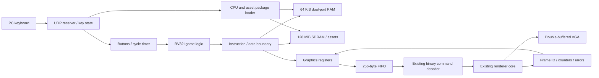

# RV32I Renderer SoC

## Current Castle deployment

The selected hardware is the 50 MHz SDRAM-execution image with the geometry
worker, setup overlap and two raster lanes. See `profiles/current-deployment.json` for its
exact identity. The generic `SoC.qpf` / `build/quartus/SoC.sof` recipes below
are historical scaffold/example builds; they do not select this topology.

From a fresh checkout with Clang, LLD and llvm-objcopy on PATH:

```powershell
.\scripts\run.ps1 soc.py bootstrap
# Build only if the selected SOF is absent. A new fit must pass timing and
# be reviewed/hash-selected before replacing the accepted hardware artifact.
.\scripts\run.ps1 build_sdram_execution.py fit
.\scripts\run.ps1 sm64_engine_slice.py game
.\scripts\run.ps1 current_deployment.py --write-cdf
# Open build/current-deployment.cdf in Quartus Programmer, program, then load:
.\scripts\run.ps1 load_game.py build/mario-original-engine-grounds-exec.package.json
```

`current_deployment.py` verifies the accepted SOF hash, package segments and recorded hardware features; it
never programs the board or changes user-owned Chain*.cdf files. A refit may
produce another hash even from unchanged source; do not silently accept it.
Castle traversal/appearance remain a scoped port, with deferred alpha decoration
and an incomplete Secret Slide mission. See [render corrections](docs/render-correctness-fixes.md).
The selected original-engine grounds package adds original movement, engine-selected
skeletal animation and normal Lakitu camera routines. It does not include the full
castle, object/mission engine, textures, dynamic mesh variants or camera cutscenes.
See [animation and camera implementation/evidence](docs/sm64-original-animation-lakitu.md).

Run the complete host suite with `python scripts/test_all.py` after installing
`requirements-dev.txt`. Fixtures are generated from pinned source into isolated
`build/test-fixtures` directories. No ROM/texture images are required for these
source-geometry tests. See [audit fixes](docs/repository-consistency-fixes.md).


The [hardware improvement record](docs/hardware-improvement-record.md) tracks
benchmark evidence, reproducible comparisons and supported resume claims.

The [interactive Quake demo](docs/quake-interactive.md) adds focused mouse look,
a GPU HUD, a moving door, an armor pickup and an original animated soldier.
It reuses the portable game path and adds a backward-compatible input wrapper;
original CPU/GPU cores and Mario logic stay unchanged.

The [source-neutral game pipeline](docs/portable-games.md) accepts shared scene
JSON from source adapters and builds either a generic explorer or a custom
RV32I gameplay module using `soc.py portable-game --project PATH`. It checks
hardware capabilities before packaging/loading. OBJ and original Quake
adapters plus two independent examples demonstrate the same build path.
Full games require deliberate engine ports and must fit the target's features
and resource limits; arbitrary unmodified games cannot be promised.

A starting repository for running a game on Jaiden Stipp's five-stage RV32I CPU
and rendering it on the FPGA 3D graphics processor. The CPU executes game logic
from local RAM and submits scenes through memory-mapped registers. The initial
target is the DE2-115 / Cyclone IV E.

The SDRAM build stores larger game assets in the board's **128 MiB external
memory** and uploads CPU/assets packages over UDP. Its profile includes all
1,043 opaque Bob-omb Battlefield terrain triangles plus animated Mario; game
code remains in 64 KiB local RAM. Build and load it with:

```powershell
.\scripts\run.ps1 soc.py sdram-game --fpga --quartus-bin "C:\intelFPGA_lite\18.1\quartus\bin64"
# Program build/quartus/SoC.sof, then:
.\scripts\run.ps1 load_game.py build/mario-sdram.package.json
.\scripts\run.ps1 keyboard_udp.py --ip 192.168.7.2 --layout mario
```

Reload after programming, power loss or KEY[0] reset. See
[SDRAM package and board-test instructions](docs/sdram.md).

Stage 4 adds a **Quake E1M1 scene explorer** using original shareware geometry
and a shared runtime/package ABI. Build both packages with
`scripts/run.ps1 soc.py game-packages --fetch-quake`, then load either
`build/quake-sdram.package.json` or `build/mario-sdram.package.json` over Ethernet
onto the same FPGA image. See [two-game build and switching instructions](docs/stage4-packages.md).

This scaffold contains real integration RTL, a small C game, deterministic
upstream adapters, directed simulations, a portable CI job, and a Quartus project
generator. The current boot application adds a **controllable Mario model** to
the flat Bob-omb Battlefield scene, including the connected starting field and
bridge area: movement, facing, jumping, terrain collision, a configurable
following camera with terrain avoidance, original skeletal animation,
and respawning run on the RV32I CPU; the FPGA GPU draws the original low-poly
model. The SDRAM image was programmed and its expanded scene loaded on October 8,
2026. The physical memory self-test and complete package readback passed; the
displayed-frame counter advanced 30 frames in a one-second sample. Full GPU
simulation verified movement and jumping. Physical animation/camera behavior,
VGA gameplay and performance across the level need an interactive user check.

For the earlier on-chip asset build, build the Mario milestone and hardware image:

```powershell
.\scripts\run.ps1 soc.py bootstrap
.\scripts\run.ps1 soc.py sm64-mario --sim --fpga --quartus-bin "C:\intelFPGA_lite\18.1\quartus\bin64"
```

After programming `build/quartus/SoC.sof`, connect ENET0 in 100 Mb/s MII mode
(JP1 set before power-up), put the PC on `192.168.7.0/24`, and run:

```powershell
.\scripts\run.ps1 keyboard_udp.py --ip 192.168.7.2 --layout mario
```

WASD or arrows move Mario, Space jumps, R respawns, and Esc stops
the sender. The sender polls global Windows keys while running. Remote key state
expires after 300 ms. See [docs/sm64-subset.md](docs/sm64-subset.md) for reusable
conversion commands, profiles, the supported source subset and network setup.
The source models and pinned CPU/GPU checkouts remain unchanged. Owned CPU
adapters add SDRAM wait states, and a reserved UDP envelope loads packages. Original
joint/clip data pose Mario's parts; flat palette colors replace textures.
The small reusable controller is not a port of SM64's original gameplay engine.
See [docs/mario-controller.md](docs/mario-controller.md) for controls, validation
and the boundaries of the future game-loading pipeline.
The [stage 2 camera notes](docs/stage2-camera.md) describe smooth following,
jump framing, terrain avoidance and reusable profile settings.
The [stage 3 animation notes](docs/stage3-animation.md) describe original
idle/walk/jump/landing clips, source preservation and CPU/upload budgets.
The [stage 1 area notes](docs/stage1-playable-area.md) describe source-preserving
multi-root import, the selected route and geometry diagnostics.



## Quick start

Requirements: Python 3.10+, Git, a RV32I-capable compiler, and a simulator.
Clang + LLD + llvm-objcopy or `riscv64-unknown-elf-gcc` + matching binutils work.
ModelSim Intel FPGA Edition supports the full VGA test; Icarus supports the
portable CPU/decoder and register tests.

From the repository root:

```sh
python scripts/soc.py bootstrap
python scripts/soc.py build-fw
python scripts/soc.py sim
```

`build-fw` builds Mario, the scene, Catch, triangle, and accelerated test images.
Use `--boot mario` to copy `build/mario.*` to `build/firmware.*` for this milestone.
The generic build command retains its earlier default `--boot scene`.
Use `--app game --boot game` to select Catch for the board.
An initial scene build fetches the pinned `sm64-port` checkout if needed.

For GNU tools:

```sh
python scripts/soc.py build-fw --cc riscv64-unknown-elf-gcc
python scripts/soc.py sim --simulator iverilog
```

Full CPU-to-VGA test, using ModelSim's `altera_mf` library:

```sh
python scripts/soc.py sim --simulator modelsim --full
```

`bootstrap` downloads both upstreams at the exact revisions in
[`upstream.lock.json`](upstream.lock.json), then generates the CPU memory boundary,
RAM initialization wrapper, and C protocol constants. It refuses to modify dirty
or mismatched dependency checkouts. Keep `external/` and generated adapters out of
commits; commit the lock and the generator instead. Local clean Git clones may be
used with `--rv32i-source PATH --renderer-source PATH`.

## Layout

| Path | Purpose |
| --- | --- |
| `rtl/soc_top.sv` | Actual CPU + memory + renderer wiring |
| `rtl/soc_memory.sv` | RAM/MMIO decode and upstream memory timing |
| `rtl/soc_mmio.sv` | Byte FIFO, completion, errors, counter snapshot |
| `rtl/boards/` | DE2-115 reset and VGA wrapper |
| `firmware/` | RV32I startup, linker, graphics API, SM64 scene viewer, Catch, triangle |
| `rtl/udp_controls.sv` | Existing Ethernet transport feeding CPU input state |
| `profiles/`, `sm64.lock.json` | Explicit graphics lowering policy and pinned SM64 source |
| `scripts/sm64_subset.py` | Strict SM64 display-list C converter and inspection commands |
| `scripts/game_assets.py`, `profiles/sm64-mario.json` | World/actor assembly, collision generation and game settings |
| `firmware/include/player.h`, `firmware/src/player.c` | Reusable integer character controller; independent of renderer and Mario |
| `firmware/include/camera.h`, `firmware/src/camera.c` | Profile-driven fixed-point camera and terrain avoidance |
| `scripts/animation_assets.py`, `firmware/src/animation.c` | Original hierarchy/clip import and reusable fixed-point pose evaluation |
| `scripts/rv32i_subset.py` | Clang-based audit of hand-ported fixed-point C |
| `scripts/keyboard_udp.py` | Windows keyboard-to-UDP sender |
| `sim/` | Register, memory, CPU/decoder, UDP controls and complete VGA tests |
| `scripts/soc.py` | Dependency setup, firmware build, simulations, project generation |
| `docs/` | Architecture, programming contract, integration roadmap |
| `fpga/` | Initial clock constraints |
| `external/` | Ignored upstream Git checkouts |
| `rtl/generated/`, `firmware/generated/` | Ignored reproducible adapters/constants |
| `build/` | Ignored firmware images, simulator libraries and logs |

## Programming model

RAM occupies `0x00000000..0x0000ffff`; CPU reset PC is zero. The graphics register
block begins at `0x40000000`. Registers require aligned `lw`/`sw`. A store to
`DATA` queues its low byte. Poll `STATUS.TX_READY` before **every** byte store.
The complete register map is in [docs/memory-map.md](docs/memory-map.md).

The Mario application uploads 326 terrain triangles and 212 actor triangles into
five persistent mesh handles. The CPU updates position, vertical velocity, facing,
the following camera and original skeletal poses, then uploads actor vertices
and sends matrices/draws. The GPU executes the complete geometry/rasterization
pipeline. Original SM64 physics, texture sampling and audio remain later work.

The retained **Catch** game moves a paddle to catch a falling block. KEY[1] moves
left, the board's KEY3 button moves right, and KEY[0] resets. It runs a paced game
loop on the CPU: sample buttons, update movement/collision/score, submit the two
mesh transforms, then wait for the displayed frame. A catch colors the block
green; a miss colors it red. Mesh geometry is uploaded once and reused. The CPU
writes the last acknowledged frame to `SOC_SCRATCH`; failure writes `0xdead0001`.
Score/miss counters remain in CPU RAM for debugging; a text HUD is future work.

The timer and synchronized buttons are readable through MMIO. The renderer keeps
its own color pages, Z buffer, palette, and mesh stores; they are not exposed as
CPU RAM in this first version. See [docs/game-runtime.md](docs/game-runtime.md)
for the CPU/GPU division and game API. The triangle regression still verifies the
direct-triangle command path separately.

## FPGA project

```sh
python scripts/soc.py quartus-project
python scripts/soc.py build-fpga
```

Select this machine's Lite executables explicitly if needed:

```powershell
python scripts/soc.py build-fpga --quartus-bin "C:\intelFPGA_lite\18.1\quartus\bin64"
```

The helper runs the native synthesis, fitter, timing and assembler stages, and
refuses to generate a new image if reported timing slack is negative. It also
avoids an observed Quartus Tcl shell issue that strips `Documents` from the local
project path when resolving a relative `--flow compile SoC` invocation.

Open the generated `SoC.qpf` in Quartus Prime 18.1, or use the CLI above, after
building firmware. The generator imports reusable IP files and the matching VGA,
clock, reset, LED and ENET0 pins, excluding both original board/demo tops.
`build/firmware.mif` initializes the 64 KiB CPU RAM. Recompile after changing it.

CPU registers capture on rising edges; RAM writes, the FIFO, decoder and renderer
use falling edges of the same 50 MHz clock. This deliberately preserves the CPU's
upstream memory timing and imposes half-cycle timing paths. Review TimeQuest
results after each hardware change. The VGA PLL has a separate direct 50 MHz
reference, and pixel-domain/output constraints come from the renderer's board
project. Ethernet RX/TX clocks and delays are also constrained. Consult the
selected artifact's `.sta.summary` for its timing. The generic project summary
is not the current geometry-worker image's timing report.

On this machine the complete project was moved to
`C:\Users\Orb1t\Documents\Codex\FPGA-Game-SoC`. For the historical scaffold, open that folder's `SoC.qpf` in
Quartus Lite; its programming image is `build/quartus/SoC.sof`. Use the current
deployment selection above for the accepted Castle hardware. Close any project
still open from the previous dated workspace path before reopening this one.

## Integration limits and next steps

There is one CPU command producer, no DMA, no shared framebuffer, and no CPU
interrupt controller. Frame completion is polled; `frame_pending` is available to
future interrupt logic. MMIO cannot stall the CPU. Full-FIFO writes are rejected
and latch an error, so firmware must obey the polling contract. RAM out-of-range
fetches return NOP; invalid data accesses return zero / reject writes. This follows
the educational CPU's lack of a precise trap mechanism.

The portable tests use synthetic frame completion after verifying decoded
commands, including 56 game ticks, scene camera controls, and MII UDP input with
sequence/CRC/timeout checks. `--full` also exercises real scene rendering after
UDP input, plus the game and triangle VGA regressions. See
[docs/validation.md](docs/validation.md) for actual validation results and
[docs/roadmap.md](docs/roadmap.md) for staged extensions.

## Upstream projects

- [jaiden-stipp/RV32I](https://github.com/jaiden-stipp/RV32I): pipeline and RAM.
- [jaiden-stipp/FPGA-3D-Renderer](https://github.com/jaiden-stipp/FPGA-3D-Renderer):
  command protocol, reusable renderer, memories and VGA.


