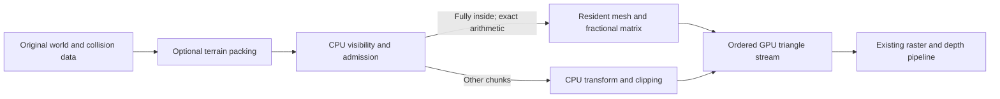

# ARCH-UPGRADE-001: Stage 0 and Stage 1 results

Measured October 10, 2026. Starting implementation: `60782c8`; replay baseline commit: `a692b8f`. Read this alongside [the architecture plan](architecture-upgrade-plan.md), [the fractional command contract](gpu-fractional-transform.md), and [all physical measurements](benchmarks/arch-upgrade-001-stage-1/measurements.json).

Stage 0's shared-terrain replay foundation is implemented. Stage 1's optional hardware/software path is implemented and passes the scoped correctness and timing checks, but **does not pass performance acceptance**. Neither experimental layout replaces the default. The FPGA was restored to `ScreenEdgesSoC.sof` and the archived, unprofiled direct Mario package; its frame counter advanced from 887 to 896 to 906 after restoration.

## What Stage 0 provides

`scripts/replay_render_route.py` compiles the production world renderer, controller/collision code and camera code into a native harness. A route fixes input masks and tick counts, area resets and either a supplied camera matrix or production orbit-camera configuration. The harness emits the actual versioned, CRC-protected GPU commands. It does not execute RV32 instructions or the complete Mario game loop.

`sim/render_frame_replay_tb.sv` feeds those commands through the real decoder, command processor, mesh store, geometry pipeline, rasterizer, depth buffer and VGA swap handshake. It records actual RAM writes to both color pages and depth, then captures the complete 320×240 displayed color-index and depth arrays plus palette state. It also records decoded commands, ordered camera-space triangles, accepted-byte timestamps, final setup/raster activity, swap request/acknowledgement, queue occupancy and transform stalls. The synthetic producer runs at 50 MHz with deterministic gaps; replay cycle spans are simulation diagnostics, not physical game performance.

`scripts/compare_render_frames.py` rejects incomplete or unknown captures, compares controller/camera state, checks ordered submitted triangles and compares every color/depth/palette sample. Three corruption tests prevent equally truncated files from falsely passing.

Archived checks:

- Seven castle orbit-camera snapshots: spawn, controlled walking, jumping, and explicit spawn resets in the remaining four areas. Both experimental terrain layouts match the baseline's **1,573 ordered submitted triangles** and every color/depth pixel across these seven frames.
- Eight authored protocol/GPU fixtures repeat exactly: empty, viewport coverage, equal-depth ordering, occlusion, degenerate, shared edge, near-plane rejection and queue pressure. Independently inspected outputs include a completely cleared empty/degenerate frame, 76,800 colored viewport pixels and first-color retention on equal-depth overlap. The archived fixture labeled `near-crossing` is rejected, not a proof of successful CPU near-plane clipping. The small-triangle queue fixture reaches occupancy 55, not queue-full saturation.
- Two static original Quake terrain views repeat exactly through the same capture/comparison pipeline. They exclude Quake controller, entities and engine behavior.

The [Stage 0 evidence folder](benchmarks/arch-upgrade-001-stage-0/manifest.json) contains compressed complete captures, traces, routes, comparison results, preserved source and artifact hashes. Full-frame means a complete buffer for the stated terrain fixture; it does **not** mean a complete animated game frame. Physical framebuffer readback, animated actors, full mission/transition routes, queue-full saturation and future DMA arbitration are not covered. Area resets are not evidence that castle transitions work.

## What Stage 1 changes

The converter can optionally split terrain at spatial centroid-cell boundaries while preserving every source face, vertex position, winding, palette index and the existing sorted face order. Shared boundary vertices may be duplicated. Legacy capacity packing remains the default. An experimental minimum-face threshold allows the second layout to be reproduced without editing source.

Fractional mesh drawing carries three unsigned remainder bytes in a new 28-byte payload, wire opcode 13. The GPU adds each remainder to the local dot product **before** the fixed-point floor. This makes the resident transform exactly match the CPU's single combined floor, including negative coordinates. Legacy drawing supplies zero remainder. Strict bounds, overflow and full-frustum admission remain in place; rejected chunks still use CPU clipping.



`rtl/soc_mmio.sv` advertises the new register using existing feature bit 31, then exposes GPU capability bit 0 at `0x400000a8`. `load_game.py` rejects a fractional package on legacy hardware before holding the CPU. It checks the old feature register first, so it never reads an unsupported new address on an older image. The firmware additionally guards admission. The CPU instruction set, SDRAM cache, game timestep, collision logic and imported models are unchanged.

The generated adaptation lives in `scripts/gpu_fractional.py`, invoked by `scripts/soc.py`. It produces replacement renderer types, decoder, processor and mesh store under `rtl/generated`; pinned external repositories remain unchanged. The internal command payload grows from 200 to 224 bits. Remainders are latched with each draw, and output remains stable under backpressure.

## Measured results and decision

Three physical standing-spawn trials per configuration at 50 MHz, with optional detailed profiling. Render spans exclude the separately measured update/presentation phases. These are completed-frame snapshots, not distributions or cycle-identical movement benchmarks. Snapshot frame IDs are retained because animated poses can differ between frames 250 and 251.

| Configuration | Render cycles, all three trials | Median CPU render | Change from accepted baseline |
| --- | --- | --- | --- |
| Accepted legacy packing, direct path, accepted image | 957403 / 957403 / 957403 | 19.14806 ms | Reference |
| Cell boundaries, direct path, candidate image | 1078875 / 1078936 / 1078869 | 21.57750 ms | +12.688% |
| Cell boundaries, fractional GPU path, candidate image | 1152836 / 1152750 / 1152750 | 23.05500 ms | +20.404% |
| Minimum 32 faces at cell boundaries, fractional path, candidate image | 1081133 / 1081144 / 1081239 | 21.62288 ms | +12.925% |

The two cell-boundary paths share the same asset bytes and candidate hardware, separating their offload choice. Comparing them to the accepted baseline also includes the packing and registered-mesh changes. No isolated hardware speedup is claimed.

For the sampled baseline frame, chunk selection costs 4,398 cycles. Cell packing raises that to 179,506 cycles on the direct path and 262,424 cycles with GPU admission. GPU offload reduces the transform scope from 303,736 to 283,669 cycles and clipping from 190,080 to 184,637, but these savings do not repay selection/admission overhead. Submitted bytes fall from 7,011 to 6,851; commands fall from 242 to 231. The cell-only native route admits 14 / 7 / 9 chunks at spawn / walk / jump, with zero repeat uploads in the latter two snapshots. Its assets grow from 883,124 to 959,216 bytes. The minimum-32 layout uses 899,604 asset bytes but admits zero chunks in the seven tested orbit views.

Observed FPS remains approximately 30 under the existing cadence; there is no FPS improvement. Native route counts are not atomic physical-frame counters. GPU spans overlap CPU submission and presentation waits and cannot be added to CPU phases.

| Fitted result | Accepted image | Registered fractional image |
| --- | --- | --- |
| Logic elements | 21,754 | 22,533 (+779) |
| Memory bits | 2,659,668 | 2,659,668 |
| 9-bit multiplier elements | 80 | 80 |
| PLLs | 2 | 2 |
| Worst setup slack | +0.365 ns | +0.364 ns |
| Worst hold slack | +0.091 ns | +0.088 ns |

The first fractional fit used 22,433 logic elements but failed setup by 0.250 ns on component selection to transformed Y output. It was never programmed. Registering the product sum restored positive timing across the reported corners, with setup and hold fully constrained. The added stage costs nine cycles per resident triangle, including legacy actor draws. Both failed-fit evidence and final reports are retained; this is a measured resource/latency tradeoff, not a higher-clock claim.

Verification includes 56 host tests, independent signed arithmetic/source-face/default-packing checks, old-hardware package rejection, fractional decoder checks, actual mesh draws with residues 0 and 255 and backpressure, read-only capability MMIO checks, existing projection/screen/depth regressions, complete terrain comparisons, firmware subset/instruction audits, full Quartus fit/timing, physical upload readback and restoration checks.

## Reproduce and inspect

Run commands from the repository root with LLVM available. `scripts/run.ps1` selects the configured Python runtime. Full renderer simulation needs the existing ModelSim/Altera library installation. Captures use a shared `build/render-replay` workspace: run full replays serially.

```powershell
# Preserved terrain reference and deterministic production camera route.
.\scripts\run.ps1 replay_render_route.py --world build/castle/world.json --route docs/benchmarks/arch-upgrade-001-stage-0/castle-orbit-route.json --world-source docs/benchmarks/arch-upgrade-001-stage-0/baseline-world.c --legacy-packing --out build/replay-reference --simulate

# Optional cell-only exact GPU path; add --min-chunk-faces 32 for experiment 2.
.\scripts\run.ps1 replay_render_route.py --world build/castle/world.json --route docs/benchmarks/arch-upgrade-001-stage-0/castle-orbit-route.json --gpu --fractional --out build/replay-fractional --simulate
.\scripts\run.ps1 compare_render_frames.py build/replay-reference build/replay-fractional --out build/replay-comparison.json

# Default packaging keeps original capacity packing.
.\scripts\run.ps1 soc.py portable-game --project build/castle/game.project.json --terrain-direct --integer-mul

# Optional fractional feature; requires the compatible candidate FPGA image.
.\scripts\run.ps1 soc.py portable-game --project build/castle/game.project.json --terrain-gpu-fractional --integer-mul

# Explicit experimental packing comparison; does not change global defaults.
.\scripts\run.ps1 soc.py portable-game --project build/castle/game.project.json --terrain-direct --terrain-tight-chunks --integer-mul
.\scripts\run.ps1 soc.py portable-game --project build/castle/game.project.json --terrain-gpu-fractional --terrain-min-chunk-faces 32 --integer-mul
```

Local rollback artifacts remain in `build/arch-stage1/baseline`. Exact experimental binaries remain in `build/arch-stage1/cell-only` and `build/arch-stage1/balanced`; their hashes and all trials are archived. The candidate image is `build/quartus-arch-stage1/ArchStage1SoC.sof`, intentionally not left running. The archived build helper/QSF and manifest document its configuration. Raw evidence has Git attributes preserving byte hashes. Generated/locally extracted game assets and SOF binaries are not added to Git.

## Next decision

Keep Stage 1 optional. Before promotion, measure and implement cheaper visibility traversal and a resident policy that selects chunks with useful transform savings. Add admission-rejection reasons without conflating live counters with completed-frame snapshots. Repeat terrain comparisons and physical trials after each change. Do not relax frustum checks, alter models/collision or increase clock frequency to conceal the regression. Finish Stage 0's actor/transition/physical-route acceptance separately. Stage 2 remains unstarted.

A defensible resume statement now is: “Built deterministic GPU command replay and full terrain color/depth differential validation; implemented a backward-compatible fixed-point mesh-transform extension and closed FPGA timing; rejected two packing variants using three-trial physical profiling.” A performance improvement claim is not supported.
