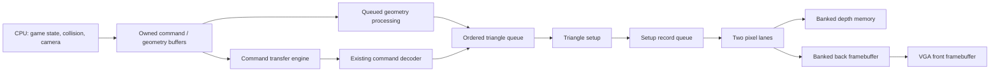

# FPGA parallel architecture upgrade plan

Plan ID: **ARCH-UPGRADE-001**. Created October 10, 2026. Status: **Stage 0 terrain foundation verified; Stage 1 optional with measured regressions; Stage 2A accepted; Stage 2B experimental/not promoted; Stage 3 optional upgrade verified and measured; Stage 4 optional two-lane upgrade accepted; Stage 5 optional geometry worker accepted and selected**.

This is the reference plan for future architecture work. Read this file, `hardware-improvement-record.md`, and the latest accepted benchmark before implementing an upgrade. Update the execution ledger when work is measured and accepted. A stage number in this document refers specifically to ARCH-UPGRADE-001, not earlier game-port milestones.

## Objective and constraints

Increase useful rendering throughput and scene capacity with parallel hardware, while preserving original imported geometry, gameplay, collision and the reproducible multi-game conversion pipeline. Keep RV32I plus the existing MUL-only extension and the corrected fixed-point rendering baseline. A new capability must have a versioned feature contract and retain the existing direct software fallback.

Do not assume a faster CPU clock, larger cache, floating-point GPU, superscalar CPU, additional CPU core, or changed game timestep is necessary. No resource estimates or speedup percentages are commitments until synthesis and physical measurements exist. Textures and new game features are separate projects.

## Accepted starting point

Source baseline: **60782c8**, the screen-edge correction commit. Physical baseline artifacts and hashes: [SCREEN-EDGES-001](benchmarks/screen-edges-001/measurements.json). User reports the output is much better; a complete-level automated framebuffer/collision acceptance route has not yet been established.

| Observed quantity | Baseline result | Scope |
| --- | ---: | --- |
| Logic elements | 21,754 / 114,480 | Fitted ScreenEdgesSoC |
| Embedded memory bits | 2,659,668 / 3,981,312 | Fitted; banking can change physical block packing |
| Embedded 9-bit multiplier elements | 80 / 532 | Fitted; not a count of full-width multipliers |
| PLLs | 2 / 4 | Fitted |
| Worst setup / hold slack | +0.365 / +0.091 ns | Reported multicorner timing; not measured maximum frequency |
| CPU render | 19.14806 ms | Median of three detailed standing animated spawn snapshots |
| Clipping scope | 231,076 cycles | Same latest baseline, 50 MHz |
| Command scope | 281,882 cycles | Same latest baseline; includes software overhead |
| Commands / bytes | 242 / 7,011 | Same matched completed frame 251 |
| Observed frame rate | Approximately 30 FPS | Existing game/presentation cadence |

Historical post-MUL profiles put transforms/outcodes near 6.34 ms and animation joint/vertex work near 1.11 ms. Those are earlier measurements, not fresh values for every route on 60782c8. Safe resident terrain offload admitted zero castle chunks in its tested view. Existing SDRAM burst cache fills and 32-byte lines are already implemented; do not count them again as new improvements.

Read [screen-edge-rendering.md](screen-edge-rendering.md), [terrain-offload-and-profiling.md](terrain-offload-and-profiling.md), [post-mul-bottlenecks.md](post-mul-bottlenecks.md), and [static-timing-analysis.md](static-timing-analysis.md) for measurement limits and existing designs.

## Target data flow

This is the target topology, not an existing connection diagram. Command and geometry paths must use an explicit ordered scheduler; they cannot independently inject triangles into a shared FIFO. Frame begin, clear, draw and end remain ordered. CPU updates can overlap rendering only where buffer ownership and game-state dependencies permit; collision and camera must see the intended simulation state.

## Stage 0 — Establish reproducible frame acceptance and counters

**First executable task.** Preserve the current accepted source, SOF, firmware and asset hashes, then add deterministic input replay and frame capture before changing datapaths.

- Fixtures: corrected edge-crossing triangles, distant depth-bound triangle, full viewport, empty frame, overlapping faces including equal depth, shared edges, degenerate faces, and maximum-capacity command traffic.
- Game cases: fixed castle views plus recorded movement routes spanning near-plane crossings, room transitions and previously problematic floor/edge views. Add a Quake package case using the same interfaces. Label coverage honestly if an adapter or capture path is unavailable.
- Compare decoded commands, submitted triangles, framebuffer color and depth, collision/player state, and completion/frame IDs. Establish allowed raster conventions once; differences require explicit review rather than a blanket tolerance.
- Add elapsed timestamps for first/last command, setup completion, raster drain, swap request and swap acknowledgment. Record queue occupancy, empty/full cycles, arbitration stalls and active work separately. Keep profiling overhead controls.
- Add simulation-only memory dumps first; physical framebuffer capture is an explicit follow-up if no readback path exists. Do not imply that current tests already capture whole gameplay frames.

**Integration:** `scripts/profile_cpu.py`, new proposed `scripts/replay_render_route.py`, new proposed `scripts/compare_render_frames.py`, existing simulation benches, `scripts/soc.py`, and generated performance-counter adaptation if new counters are needed.

**Exit:** replay is repeatable, reference outputs archived, completed-frame snapshots agree on IDs, and ordinary unprofiled Mario is restored. If whole-frame differences are nondeterministic, resolve them before optimization.

## Stage 1 — Make existing GPU terrain offload usable

Start with the existing GPU rather than immediately duplicating transform hardware.

1. Update generic world packaging to create tighter chunks within the existing 128-vertex / 256-triangle mesh limits. Preserve original vertices, winding, materials and collision. Duplicate boundary vertices only where required by packing; retain source-face IDs for comparison.
2. Extend the generated GPU transform contract to carry enough translation precision to match the corrected CPU transform rounding. Specify intermediate widths, signed shifts, overflow checks, near/far planes and clipping policy in an ABI document before RTL changes. Never relax admission merely to raise the admitted count.
3. Keep CPU clipping for frustum-crossing chunks initially. Expand GPU clipping eligibility only after independent equivalence tests pass.
4. Measure admitted/rejected chunks by rejection reason, mesh residency churn, upload bytes, CPU preparation cycles and GPU geometry stalls. Preserve atomic mesh upload/draw ownership: no mesh slot may be overwritten while a queued frame references it.

**Integration:** `scripts/portable_game.py`, shared world packaging identified during implementation, `firmware/src/world.c`, `scripts/soc.py`, generated `transform_3d_pipeline.sv`, and shared mesh interfaces. Pinned external sources remain unchanged.

**Exit:** original castle chunks actually use GPU drawing in controlled views, differential geometry/framebuffer checks pass, fallback still works, and a measured workload benefit outweighs upload/admission cost. If residency churn eliminates the benefit, record that outcome and keep direct rendering as default.

## Stage 2 — Reduce CPU command transport work

### 2A: Packed MMIO enqueue

Add a separately advertised packed-write capability without changing the legacy `GFX_DATA` low-byte-per-word behavior.

- Define an enqueue operation for one through four bytes. Specify byte ordering and valid-byte count, including command tails, before assigning addresses in the audited MMIO map.
- Enqueue is atomic: either all requested bytes are accepted exactly once or none are accepted. Never partially consume a word. Insufficient capacity has defined status/error behavior; it must not silently drop bytes or trap the CPU indefinitely.
- Feed the existing versioned byte decoder and CRC verification. Preserve decoded commands exactly. Benchmark firmware CRC/check/write costs separately; packed writes do not automatically eliminate CRC computation.
- CPU is the only producer in this substage. Refresh readiness/reservation semantics for multi-byte capacity.

**Integration:** `rtl/soc_mmio.sv`, `rtl/soc_memory.sv`, `firmware/include/soc.h`, `firmware/src/gfx.c`, generated command-stream wrapper through `scripts/soc.py`.

### 2B: Read-only command transfer engine

After 2A has a measured result, add a proposed `rtl/gfx_command_dma.sv` and shared-memory arbiter. Begin with one active descriptor and two software buffers; a multi-entry hardware ring is optional later work.

**Proposed control fields:** ABI/capabilities, source address, byte length, submission ID, start, busy/error status and completed submission ID. Exact MMIO offsets and feature bits remain unassigned until collision auditing. DMA completion means all bytes were accepted by the decoder-facing stream; GPU frame completion remains a separate event.

**Memory/ownership rules:**

- CPU fills a buffer, waits for its writes to be acknowledged, then transfers ownership by starting the engine. It cannot reuse or mutate the buffer until transfer completion. Do not assume generic fences or interrupts exist in this CPU; implement and test the actual submission ordering contract.
- Initial DMA reads only approved aligned SDRAM ranges, with explicit tail handling and bounds/length checks. It bypasses the CPU cache; acknowledged write-through CPU stores must reach SDRAM before ownership transfer. Do not allow DMA writes in this stage.
- `soc_memory` currently lacks an independent accelerator master. Add explicit arbitration beneath the CPU cache with request ownership carried through responses, not a combinational mux of unrelated ready signals.
- CPU and DMA requests must have bounded service opportunities. Bound bursts and handle refresh, queued responses and reset without lost or misrouted responses. Measure CPU freeze regressions while DMA runs.
- CPU direct byte writes and DMA output have exclusive stream ownership per submission. Do not interleave fragments from different producers. Loader BEGIN must quiesce/cancel outstanding work and drain responses before memory replacement; reset cancels ownership safely.

**Exit:** byte-for-byte transport equivalence under randomized backpressure, boundary/tail tests, loader/reset tests and physical readback pass. Accept only if total CPU/frame work improves; DMA may lose on small command buffers due to CPU packing and memory traffic.

## Stage 3 — Overlap triangle setup with rasterization

The current renderer owns setup, division, rasterization and drain in one state machine. Split setup into a producer and raster traversal into a consumer, with a ready/valid setup-record queue.

**Proposed module:** `rtl/triangle_setup_engine.sv`, integrated through the generated renderer adaptation. Start with a two-entry queue as an experiment, not a claimed optimum; compare occupancy and throughput before increasing it.

A setup record contains clipped bounds, signed edge starts/steps and fill-rule data, depth start/steps, minimum/maximum vertex depth, color and frame/order metadata. Widths come from the existing validated arithmetic or explicitly proven replacements. Existing depth-gradient divisions already run concurrently for X and Y; do not count that as a new feature.

Setup for triangle N+1 may run while N rasterizes. Queue records remain stable under backpressure. Empty/culled triangles must still retire in order. END_FRAME waits for setup, queues, raster and depth writes to drain before swap.

**Exit:** exact output equivalence at the established depth/fill conventions, reduced setup-induced raster idle cycles in suitable fixtures, and positive physical timing. A speedup in small-triangle fixtures is not automatically a game improvement.

## Stage 4 — Two pixel lanes with banked depth and color memory

Add two adjacent-pixel lanes to one ordered triangle traversal. This is spatial parallelism within a triangle, not two independent triangles racing on the same framebuffer.

- Lane 0 owns even X, lane 1 odd X. Bank address is `y * 160 + (x >> 1)` for the existing 320-pixel width. Handle odd left/right bounds with lane masks.
- Each lane has edge evaluation, depth interpolation with the accepted vertex-extrema clamp, depth read/compare and conditional depth/color writes. Preserve strict greater-than depth testing and existing equal-depth order behavior.
- Bank depth memory into independent read/write streams. Bank both color pages and adapt VGA reads to select the bank from X parity with correctly aligned valid, coordinates and data across the display-clock boundary.
- Maintain or explicitly bypass read-after-write hazards within each bank. Never depend on the current RAM's DONT_CARE mixed-port same-address behavior. Drain outstanding writes before advancing an ordering barrier or swapping pages.
- Clear both banks in parallel. Keep clear/raster ownership exclusive initially; overlap clear with unrelated CPU/setup work only where frame ordering is proven safe.
- Measure physical M9K block usage, not just logical bit totals. Banking/width choices can waste blocks and consume the tighter memory budget.

**Integration:** generated `renderer.sv` and graphics pipeline wrappers via `scripts/soc.py`; generated adaptations of `depth_test_stage.sv`, `zbuffer.sv`, `zbuffer_ip.v`, `framebuffer.sv`, `framebuffer_ip.v`; page swap/display interfaces. Keep pinned external files unchanged.

**Exit:** lane-boundary, single-pixel, overlapping/equal-depth, shared-edge, clear/reset/swap and randomized-backpressure tests pass; complete framebuffer/depth comparisons pass; measured raster cycles decrease in representative views without a harmful overall regression. Two lanes imply a possible pixel-rate increase, not a guaranteed twofold frame-rate increase. Four lanes are deferred until two-lane memory/timing results justify them.

## Stage 5 — Optional independent math accelerator

Reassess after stages 1–4. Choose one remaining measured bottleneck:

- A queued geometry worker for CPU-fallback transforms/outcodes or clipping, if substantial CPU geometry work remains after resident offload. Preserve the 16-bit fraction and exact interpolation semantics. Use the ownership/arbiter contracts above; keep ordered output assembly.
- A skinning worker if animation becomes a significant frame cost. Inputs are generic joint transforms, bind-pose vertices and weights; output is a render-owned posed-vertex buffer. Preserve engine animation state and timing. The current one-matrix mesh path is not a replacement for skeletal skinning.

Do not implement both speculatively. Add a proposed `rtl/geometry_worker.sv` or `rtl/skinning_worker.sv` only after a concrete format/equivalence fixture and attributable workload cost exist.

**Exit:** independently verified arithmetic, bounded descriptors, buffer/reset safety, and measured benefit including data movement. A second general-purpose CPU is deferred because software concurrency and shared-memory overhead remain unmeasured.

## Stage 6 — Timing and frame-cadence reassessment

Timing closure is mandatory at every earlier stage. This stage is a deliberate frequency/throughput experiment after useful parallelism exists.

- Requery critical paths on the latest fit. The historical RAM/loader half-cycle path, CPU forwarding/branch-target path and GPU area/culling path are candidates, not guaranteed current critical endpoints.
- Register/handshake paths where appropriate; preserve latency contracts. Do not add unproven false-path or multicycle exceptions. Audit SDRAM and Ethernet external timing, PLL constraints and clock crossings.
- Keep 50 MHz initially. Change frequency only after all modeled checks pass for the proposed constraints and physical tests run.
- If measuring uncapped render throughput, separate rendering cadence from the fixed simulation timestep first. Report useful render time, presentation waits and observed FPS separately. Do not accelerate gameplay by changing the tick period.

**Exit:** documented multicorner setup/hold/recovery/removal/pulse checks, constrained-path coverage, physical reliability and an attributable throughput improvement. No Fmax estimate substitutes for a physical result.

## Evidence and acceptance contract for every stage

1. Commit a clean accepted baseline before measurable hardware changes. Stage independently selectable hardware/firmware variants; change one architectural feature per comparison where practical.
2. Archive commit IDs, tool versions, clocks, RTL/configuration hashes, SOF and firmware hashes, asset hashes and workload/input identity. Separate synthetic fixtures, fixed views and movement diagnostics.
3. Run at least three physical trials per configuration as the initial comparison, reporting all values, medians and variation. Extend sampling if noise prevents a conclusion. Add frame-time distributions for recorded routes where supported; do not represent one completed-frame snapshot as a distribution.
4. Report useful CPU cycles, retirement/freezes/bubbles, command CRC/check/write costs, submitted bytes, accelerator activity/stalls, arbitration waits, queue occupancy, geometry/setup/raster/clear spans, drain/swap timestamps and actual frame progress where available. Nested/overlapping counters cannot be summed into serial frame time.
5. Run appropriate host/RTL arithmetic and interface regressions, differential full-frame tests, firmware instruction audit, full Quartus fit and timing, loader readback and physical route checks. Every new capability has old-package/fallback compatibility tests.
6. Record utilization, timing and every observed tradeoff. Label predictions as hypotheses; record unsuccessful experiments. Do not claim power, maximum frequency, complete-game speedup or complete-level acceptance without those measurements.
7. Accept correctness first, then workload benefit within fitted resources/timing. Restore the accepted unprofiled game/image after every experiment; preserve rollback artifacts. Record the accepted commit and update `hardware-improvement-record.md` with a scoped resume claim only when evidence supports it.

Raw evidence naming: `docs/benchmarks/arch-upgrade-001-stage-N/`, with substage suffixes where needed. Proposed standard files: `measurements.json`, `manifest.json`, `acceptance.md`, per-trial profiles, comparison outputs, programming/build logs and raw timing/resource reports. Hash raw bytes and preserve them with explicit attributes as in existing benchmark folders.

## Execution ledger

| Stage | State | Accepted commit / evidence | Next decision |
| --- | --- | --- | --- |
| 0: replay / baseline | Shared-terrain foundation verified; full actor/transition/physical-route acceptance pending | Baseline 60782c8; replay commit a692b8f; [results](architecture-stage-0-1.md) | Extend the deterministic harness to complete game frames |
| 1: usable terrain offload | Optional implementation verified; performance acceptance failed for both tested layouts | [Three-trial measurements](benchmarks/arch-upgrade-001-stage-1/measurements.json); original image/game restored | Reduce selection/admission cost and improve residency before promotion |
| 2A: packed enqueue | Optional transport accepted; normal packed Mario loaded; full-frame terrain equivalence verified | Implementation 2f226d6; [results](architecture-stage-2a.md) | Ordinary standing update+render improves 0.864%; extend route coverage before changing global defaults |
| 2B: command DMA | Experimental implementation verified; not promoted | Hardware 59a4d3a, local staging 40e4ee1; [results](architecture-stage-2b.md) | Final ordinary CPU update/render regresses 8.52%; packed Stage 2A image/game restored |
| 3: overlapping setup | Optional upgrade accepted; Stage 3 rollback preserved | Baseline 6153efa; implementation 2bf56dd / 8bb928c; [results](architecture-stage-3.md) | Exact 17-frame replay match; medium resident-mesh work before swap wait improves 2.176%; ordinary CPU/FPS unchanged; Stage 4 comparison completed; preserve this rollback |
| 4: two pixel lanes | Optional upgrade accepted; Stage 4 rollback preserved | Baseline 8082afd; implementation b465b03 / 721fada; [results](architecture-stage-4.md) | 17 exact replay frames; largest synthetic probe saves 49.3% before swap wait including parallel clear; ordinary CPU/FPS unchanged; +396 LEs / +12 M9Ks |
| 5: optional math worker | Geometry worker accepted and selected; skinning deferred | Baseline 40219cec; implementation b677581 / df0649df; [results](architecture-stage-5.md) | Standing CPU update/render improves 28.319%; transform/outcodes 82.410%; exact three complete actor/game stream and GPU replay frames; reassess remaining clipping/command cost |
| 6: timing/cadence | Optional repeat-safe cadence accepted and selected for Castle; frequency unchanged | Baseline e50d34f; firmware a854e1e; [results](architecture-stage-6.md) | Twelve atomic physical trials: standing median 29.97 to 59.96 FPS; movement 29.98 to 44.29 FPS; fixed simulation tick retained; 85 RTL/constraint files unchanged |

Stage 2B staging measurement and implementation are complete. Staging-only savings did not transfer to the integrated game: final command-local DMA is 8.52% slower than packed in ordinary standing CPU update/render time, with FPS near 30. Stage 2A remains the selected transport; Stage 3 adds optional setup/raster overlap; Stage 4 adds adjacent-pixel lanes and parity-banked depth/color RAM with normal packed Mario. Keep DMA experimental; measure lower-cost word/span serialization before further DMA hardware changes. Extend Stage 0 actor/transition/physical-route coverage, improve Stage 1 selection/admission economics, and preserve the measured Stage 3 rollback and Stage 4 control/candidate artifacts. Stage 4 improves measured GPU spans; selected Stage 5 adds the shared geometry worker and improves ordinary standing CPU update/render 28.319%, with FPS still around 30. Preserve both rollbacks and reassess clipping/command costs and cadence before duplicating more lanes. Do not combine geometry, transport and clock changes in an unseparated performance claim. Physical board measurements and deployment require one owner.

Stage 6 reanalyzed the unchanged accepted Stage 5 fit and separated optional render cadence from the original fixed simulation tick. It improves measured presentation rate, with repeated simulation states and no interpolation. The clock remains 50 MHz. Full-level routes and CDC electrical/routing bounds remain separate acceptance work. Preserve exact Stage 5 software rollback and use the repeat-safe adapter contract for other games.
