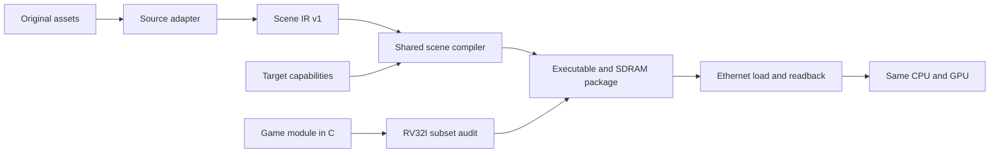

# Source-neutral game pipeline

The optional [interactive Quake demo](quake-interactive.md) demonstrates shared
input, HUD, object and frame-animation services on target `de2-115-fixed-v2`.
That target needs the IN v1 input-wrapper image. The commands and limits below
describe the original `de2-115-fixed-v1` path, which remains supported.

The platform can load different games through adapters and deliberate engine
ports. It cannot promise to run any unmodified 3D game. The current target has
64 KiB for code/state/stack, 128 MiB for assets, 16 resident mesh handles,
flat palette colors, fixed-point arithmetic and a five-bit control interface.
Textures, shaders, audio, an OS and CPU floating point are unsupported.
A converter cannot supply those engine or hardware capabilities by itself.

The new build path has no game-name branches. Source-specific work ends at a
shared scene format; gameplay enters through a direct-call C port interface.



## Commands

Run from the repository. These commands preserve the programmed FPGA image and
the existing Mario/Quake packages. Stop the keyboard sender during uploads.

```powershell
# Source-independent authored scene, no downloaded game data:
.\scripts\run.ps1 portable_game.py check examples/portable-room/game.project.json
.\scripts\run.ps1 soc.py portable-game --project examples/portable-room/game.project.json
.\scripts\run.ps1 load_game.py build/portable-room-sdram.package.json

# A separate game module using the same compiler/runtime, with its own input and drawing logic:
.\scripts\run.ps1 soc.py portable-game --project examples/custom-port/game.project.json
.\scripts\run.ps1 load_game.py build/portable-custom-sdram.package.json

# Original Quake source adapter -> the same shared compiler and generic explorer:
.\scripts\run.ps1 portable_game.py export-quake
.\scripts\run.ps1 soc.py portable-game --project build/quake.scene-ir.project.json
.\scripts\run.ps1 load_game.py build/portable-quake-sdram.package.json
.\scripts\run.ps1 keyboard_udp.py --layout quake

# A triangulated, Y-up, outward-wound OBJ exported from another source:
.\scripts\run.ps1 portable_game.py export-obj --obj C:\assets\level.obj --out build/my-level.scene.json --name my-level --extent 2048 --spawn 0 0 0
.\scripts\run.ps1 portable_game.py check build/my-level.scene.project.json
.\scripts\run.ps1 soc.py portable-game --project build/my-level.scene.project.json
.\scripts\run.ps1 load_game.py build/my-level-sdram.package.json
```

The default explorer uses W/S to walk, A/D to turn, Space to jump and R to
respawn. The custom example deliberately owns different behavior: A/D rotates
the cube in quarter turns, W/S moves it in depth and R resets its pose. It does
not use the explorer's physics. Both use the same existing keyboard packet.

`export-quake` requires the original shareware PAK from stage 4, or `--pak PATH`.
Its explicit region/material selection remains in the source adapter; the
shared compiler does not select faces. Existing Mario and Quake build commands
remain supported. Mario's original animation/data adapter is retained.

`export-obj` uses the existing OBJ converter: it centers referenced bounds,
normalizes the largest extent, triangulation must already be done, and flat Kd
colors receive its declared directional face shading. Texture/alpha material
requirements are rejected. Spawn is selected on a supporting floor at the
requested normalized X/Z below Y+36. Its report records these conversion
policies and source/material hashes. A different appearance/coordinate policy
belongs in an explicit source adapter rather than an implicit fallback.

## Scene and project contracts

[scene-ir-v1.schema.json](../schemas/scene-ir-v1.schema.json) defines the exchange
format. An adapter can be any offline tool that emits this JSON:

| Field | Meaning |
| --- | --- |
| `target` | Hardware ID, runtime ABI and required feature names |
| `coordinates` | Source origin, positive uniform scale and signed axis permutation, e.g. `[1,3,2]` for Z-up to Y-up |
| `palette` | RGB entries; entry zero is the clear/background color |
| `meshes` | Unique source IDs, world/actor roles, numeric vertices and `[a,b,c,palette]` triangles |
| `controller` | Optional shared-controller spawn in source coordinates; physics/camera values in normalized GPU units |
| `projection` | Focal/near settings for custom ports without shared physics |
| `provenance` | Adapter-specific original data hashes, selection and appearance policies |

World vertices subtract the declared source origin; actor vertices retain their
local origin. Both use the declared uniform scale and axes. Reflection reverses
triangle winding. Only referenced vertices are packed; every supplied triangle
is retained. Handles are assigned to world chunks followed by actor chunks;
`logical_meshes` in the conversion report maps source IDs to handle ranges.
Actor instances, animations and gameplay transforms are owned by the game port.

The compiler splits meshes into hardware-sized chunks without decimation,
palette approximation or dropped faces. It rejects invalid indices, non-finite
coordinates, degenerate source triangles, triangles collapsed by quantization,
coordinate overflow, excess palette entries and scenes exceeding resident
capacity. It reports rounding error and source-triangle mappings. Large scenes
need explicit source selection now; automatic runtime streaming is not present.
Actor meshes may explicitly set `retain_degenerate_actor_faces` to preserve
original animation/seam faces with zero area in a pose. Those faces remain in
the package and are counted in the report; world meshes cannot enable this.

[game-project-v1.schema.json](../schemas/game-project-v1.schema.json) selects
the scene file and port. Paths are relative to the project file:

```json
{
  "format": "soc-game-project",
  "version": 1,
  "name": "my-game",
  "scene": "scene.json",
  "port": {"kind": "custom", "sources": ["game.c", "physics.c"], "exports": ["my_physics_step"]}
}
```

Custom `.c` files live inside the repository. The `exports` list permits named
cross-file helpers/globals in the subset audit; every symbol must resolve in
the final link. It does not supply a library or bypass numeric/indirect-call
checks. Single-file modules need no extra export list.

## Porting gameplay without game-specific hardware

[game_port.h](../firmware/include/game_port.h) defines three direct functions:

```c
int game_port_init(void);
void game_port_update(uint32_t buttons);
int game_port_render(uint32_t frame);
```

The common entry point owns SDRAM self-test, asset upload, the 30 Hz clock,
bounded catch-up and displayed-frame completion. A module initializes state,
updates it once per tick and submits a complete frame through the existing
`gfx_*` API. It may use the shared controller or its own physics, animation and
draw logic. Generated `portable_data.h` exposes mesh descriptors and asset
handles; controller/world descriptors exist only when requested by the scene.
Assets are defined in one translation unit, avoiding duplicate SDRAM tables.

The compiler's host side can read source floats. Runtime C remains the current
freestanding RV32I subset: integer/fixed-point operations, static storage/stack
and direct calls. Floating point, OS/library dependencies, implicit arithmetic
helpers and indirect calls fail the mandatory Clang audit. Linker checks reserve
4 KiB of stack and the SDRAM self-test page. A scene check establishes asset
compatibility; only the audited/linked build establishes a runnable port.

This architecture lets each game's renderer/platform bindings be adapted while
preserving original algorithms/models where they fit. A full engine can require
substantial work if its original numeric types, callbacks, memory use or graphics
features exceed the target. Scene conversion alone is not an engine port.

## Capability checks and evolution

[de2-115-capabilities.json](../profiles/de2-115-capabilities.json) is the current
target contract. New packages include a `target` declaration; the loader rejects
unsupported target/runtime versions or features before BEGIN holds the CPU.
Older transport-only packages remain valid. This gate checks declared
compatibility, not the honesty or frame performance of arbitrary game code.

GPU mesh limits remain 16 handles, 128 vertices and 256 triangles per handle;
the palette holds 256 colors. The compiler's near plane is at least 257 units
to keep the existing eight-bit inverse depth representable. Neither the CPU
nor GPU RTL changes in this milestone. Existing small raster cracks remain.

Future streaming, textures, larger coordinate formats or CPU execution from
SDRAM need real implementation, new capability versions and corresponding
tests. The pipeline makes those extensions explicit; it does not claim them
already supported. A floating-point GPU can become another target backend
later while source adapters and game-module boundaries remain useful.

## Validation

```powershell
.\scripts\run.ps1 test_portable_pipeline.py
# After exporting/building the generic Quake project:
.\scripts\run.ps1 soc.py sim --simulator modelsim --full --tests portable_scene_top_tb
```

Tests cover original Quake round-trip geometry/palette/collision, preservation
of every source triangle, axis reflection, capacity/feature failures, malformed
numeric inputs, optional independent gameplay, CPU float rejection, native
explorer movement/jump and pre-upload target rejection. The custom and explorer
examples build from the same project command. Full Quake simulation captures
real GPU pixels after MII controls and RV32I turn/walk/jump. Hardware upload
readback and frame progress qualify all three packages on the same SOF.

The final run passed 70 host tests (13 new plus 57 existing). Both generic
Quake captures are pixel-for-pixel identical to the previous Quake package;
CPU plus active GPU work is 10.98 ms standing and 11.70 ms moving. Room, custom
gameplay and Quake packages each advanced 30 displayed frames in a one-second
physical board sample after complete upload/readback. These samples establish
the tested examples, not performance for arbitrary ports. See the
[validation record](validation.md) for evidence and remaining limits.


## Independent render cadence (Stage 6)

`--uncapped-render` renders whenever the previous frame has been presented,
while movement, input consumption, camera and animation advance at the existing
1,666,667-cycle simulation tick (approximately 30 Hz at 50 MHz). Presentation
still uses the existing vertical-blank page-swap handshake. Without `--interpolate-render`, adjacent presentations may show the same
simulation state.

A port must explicitly declare `"render_repeat_safe": true` inside its project
`port` object. That declaration means `game_port_render` may be called repeatedly
without advancing gameplay, transitions, camera smoothing or animation phase.
Move those state changes into `game_port_update` before declaring another port
safe, and verify its repeated-render output/state. The Castle adapter declares
this capability; other adapters retain their existing pacing. Omitting the flag
retains tick-paced rendering even for a repeat-safe port.

```powershell
.\scripts\run.ps1 soc.py portable-game --project build/castle/game.project.json --terrain-direct --packed-gfx --integer-mul --geometry-offload --uncapped-render
.\scripts\run.ps1 load_game.py build/mario-castle-sdram-direct-packed-mul-geometry-uncapped.package.json
```

The package records the cadence and hardware requirements. New firmware also
publishes a 24-word, double-buffered completed-frame cadence snapshot (ABI
`0x43540101`) for `profile_cpu.py`. It separates simulation ticks, tick waits,
update/submission/presentation spans and the matching GPU counters. CPU and GPU
work overlap. Elapsed-cycle counters are 32-bit; absolute simulation-rate
estimates use fresh short reset trials, not counters read after wraparound.
See [Stage 6 results](architecture-stage-6.md) for the actual workload and limits.


## Optional render interpolation and deferred appearance

An adapter declaring `port.render_interpolation: true` may use
`--uncapped-render --interpolate-render`. It implements
`game_port_render_interpolated(frame, alpha)`, where alpha is unsigned Q16 in
0..65536. The scheduler computes alpha from the last completed fixed simulation
tick. The adapter retains previous/current snapshots; drawing must not change
simulation, camera following, animation phase or transitions. Reset both
snapshots after an area transition or respawn. Interpolating previous/current
poses introduces approximately one tick of presentation latency. Collision and
input still advance at the original simulation cadence; interpolation does not
increase the physics rate. Rebuild rotation matrices from interpolated angles
rather than blending matrices into a potentially singular transform.

World IR areas can supply `triangle_render_flags`, one integer per face.
Zero is ordinary drawing; one means appearance is deferred on this target.
The compiler retains every face and source ID and separates chunks by flag.
`world_prepare` excludes deferred chunks from upload/visibility, and `world_draw`
skips them. Collision is independent. This is explicit adapter capability
lowering for unsupported alpha/decal appearance; it is not runtime streaming
failure. Missing metadata defaults to ordinary drawing. Rebuild firmware and
assets together because `world_chunk_t` now includes the flag field; do not mix
old firmware with newly compiled world data.

The Castle adapter uses this policy for original alpha/transparent/decal roots,
which previously produced opaque surfaces and ground bands. The exact original
textures, cutouts and blended shadows remain future work. See
[render correction evidence](render-correctness-fixes.md).
