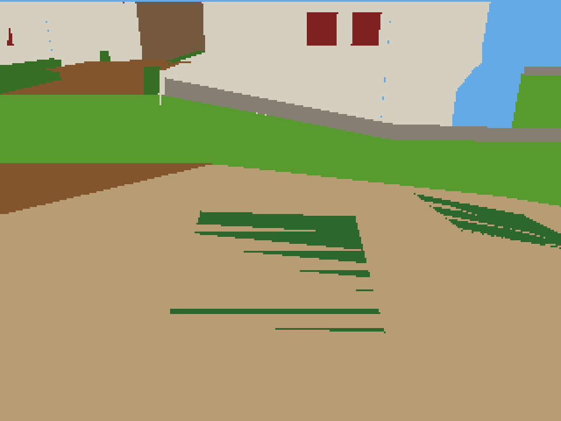
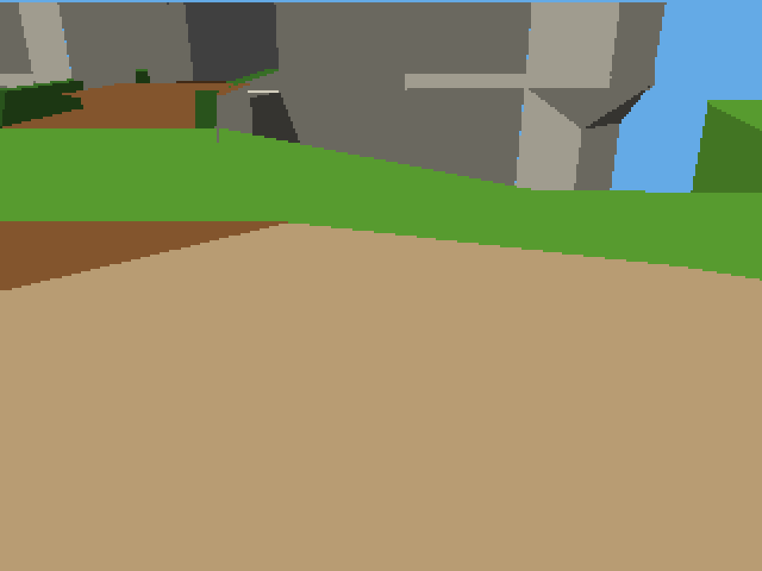

# Gameplay rendering corrections

The camera-dependent green ground bands were original transparent tree-shadow
faces being lowered into opaque foliage-colored polygons. The flat-color GPU
then depth-tested those surfaces against the path. The source root
`castle_grounds_seg7_dl_0700B1D0`, layer `LAYER_TRANSPARENT_DECAL`, contains 52
such faces and references `outside_0900BC00`. Increasing depth precision changed
the bands but did not supply the missing transparency/decal semantics.

Baseline: `15ce91c8080c965166296fae999d37387bba7f77`; scope checkpoint `d84c8a4`;
implementation: `8f46e2c4f11df44e87adf09b086d460d7ca2da90`.
The accepted 50 MHz Stage 5 hardware image is unchanged. Its SHA-256 is
`e2b1dce3d5814f348e0ca88b38fe49e494e68fddd9e897aeeac4c3a75b7c6e14`.

## Implemented corrections

- The adapter marks alpha/transparent/decal faces as deferred appearance.
  The shared world compiler keeps every face and source ID in SDRAM, partitions
  by flag, and the renderer skips their upload/drawing. Structural geometry and
  collision remain available. Other adapters default to ordinary drawing.
- The exporter retains original baked vertex brightness where lighting is
  disabled, then applies declared quantized face lighting to flat material
  swatches. The palette changes from 101 to 146 entries. Direction, ambient and
  brightness levels are authored policy in the profile, not recovered texture
  data or measured performance constants.
- Adjacent CPU-clipped triangles sort shared-edge endpoints before computing
  and rounding intersections, so opposite edge traversal emits the same point.
- Presentation interpolates previous/current player position, camera angles and
  translation, facing and original animated vertices. Rotation matrices are
  reconstructed from angles. Area changes and respawns reset history. Original
  movement, collision, camera-following and animation-step rules still run at
  1,666,667-cycle simulation ticks with catch-up capped at four. Interpolation
  does not modify simulation state and adds approximately one tick of visual
  latency. Poses are evaluated once per update and cached for repeated renders.

## Preservation and validation

| Area | Stored terrain faces | Original collision faces | Deferred appearance faces |
|---|---:|---:|---:|
| Castle grounds | 785 | 879 | 134 |
| Ground floor | 2,181 | 2,144 | 118 |
| Upper floor | 2,546 | 2,019 | 56 |
| Basement | 1,419 | 1,395 | 52 |
| Secret Slide | 1,347 | 1,126 | 46 |

All ordered vertex/triangle positions, collision data, room membership,
transitions, event exits, original actor meshes and imported animation compare
exactly against the preserved source IR. All 8,278 terrain faces remain stored;
406 appearance faces are deferred. Alpha cutouts, tree shadows, transparent
windows/overlays and paintings can therefore be absent until supported. This
is an explicit appearance limitation, not missing collision or a streaming fix.
The slide star mission and original full SM64 engine remain incomplete.

34 native world tests, five independent interpolation/clipping/source tests,
and five scheduler/capability tests pass. Randomized arithmetic checks compare
3,000 lerps and 3,000 shared-edge intersections against independent integer
oracles. Integration checks verify repeated command bytes, endpoint poses,
non-mutating render state, transition resets and deferred upload/draw behavior.
Normal and test packages pass specialized-C and linked instruction audits.

A deterministic two-frame castle approach through the production terrain and
controller paths reproduces the ground bands with the old appearance policy.
Both corrected full VGA framebuffer captures show a clean path and shaded
castle surfaces. This replay excludes actors and complete game behavior; native
integration tests cover the actor path. The current accepted generator produces
byte-identical color, depth and palette captures to the corrected replay with
experimental macros disabled. All 85 archived RTL/SDC inputs match Stage 6
hashes after regeneration. Physical uploads use complete CPU/SDRAM readback.
Phone footage alone cannot establish full-level correctness.

## Physical measurements, October 12, 2026

Three fresh reset trials per version and condition, approximately 5.3 seconds
of host-timed completed-frame sampling after three seconds of standing warm-up.
The exact baseline and candidate CPU/asset hashes are in package manifests and
raw trial files. The same verified SOF was programmed before the comparison.

| Workload | Stage 6 median FPS | Corrected median FPS |
|---|---:|---:|
| Standing spawn | 59.93813 | 59.79302 |
| Timed movement diagnostic | 44.85692 | 59.95759 |

The movement median change is 33.664%. Standing
presentation remains near the existing VGA cadence. Movement inputs follow the
same wall-clock schedule but are not cycle-identical; final player positions
vary across runs. This is a combined software comparison: deferred surfaces
reduce geometry/pixel work, shading changes palette data, canonical clipping
changes intersections, and interpolation/cached pose evaluation changes CPU
work. It does not isolate any one optimization or establish constant 60 FPS in
all areas. It is not a CPU/GPU hardware speedup.

Atomic snapshots estimate cumulative simulation throughput at 29.82–29.93 Hz
in these short trials; startup and snapshot timing affect that estimate. The
configured period remains unchanged. Individual completed-frame CPU snapshots
can contain zero updates, especially with uncapped rendering; their medians
are not average update costs. CPU and GPU work overlap. Raw counters and all
input/sample timestamps are preserved rather than summed into false timings.

Baseline CPU segment: 27,108 bytes; corrected: 29,124 bytes. Assets: 883,124
versus 883,160 bytes. The full loader verifies both segments. The experiment
runner restores the old package in a finally block before final selection.

## Unselected hardware experiments

| Resource | Accepted Stage 5 | Experimental 12-bit depth | Difference |
|---|---:|---:|---:|
| Logic elements | 26,557 | 26,808 | +251 |
| Logical memory bits | 2,659,688 | 2,966,888 | +307,200 |
| Physical M9K blocks | 366 | 406 | +40 |
| 9-bit multiplier elements | 92 | 100 | +8 |
| PLLs | 2 | 2 | 0 |

These are actual fit results, not predicted resource costs. Experimental
TimeQuest minima are setup +0.465, hold +0.087, recovery +2.787, removal +2.418,
and pulse +9.193 ns under the inherited constraints. Neither a higher Fmax nor
a timing improvement is claimed from fit-to-fit slack variation. The accepted
image retains its previous timing audit: setup +0.424, hold +0.128, recovery
+2.996, removal +3.478 and pulse +9.194 ns. External timing assumptions remain.

The 12-bit experiment passed targeted simulation and Quartus fit/STA/assembly,
but did not remove the visible banding; it was never programmed. Q4 subpixel
depth-plane setup also passed targeted tests and replay, but was not fitted or
programmed. No physical FPS is reported for either. Archived sources, logs,
reports and captures permit comparison. The approximate floating oracle uses
integer-projected triangles and incomplete alpha/rounding semantics; its pixel
disagreements are diagnostic, not original-game accuracy scores. Both generator
experiments were removed from normal builds after identifying the source issue.

## Reproduce and roll back

See [Castle pipeline commands](castle-world-pipeline.md#rendering-corrections-october-12-2026)
and [portable rendering contracts](portable-games.md#optional-render-interpolation-and-deferred-appearance).
The exact old rollback package remains locally in
`build/render-fixes/baseline/mario-castle-sdram-direct-packed-mul-geometry-uncapped.package.json`.
Build firmware and assets together; the new world chunk flag changes the
in-memory layout. `--legacy-flat-colors` reproduces the old appearance policy,
but only the archived baseline binary restores the exact old software.

[Raw measurements](benchmarks/render-correctness-001/measurements.json),
[source preservation](benchmarks/render-correctness-001/source-preservation.json),
[hardware source hashes](benchmarks/render-correctness-001/hardware-source-comparison.json).
Assets and SOFs are hash-identified local artifacts; asset package binaries and SOFs are omitted from the archive. Full mission completion, every room/transition route,
and user-observed physical VGA quality remain separate acceptance work.

## Selected deployment

The corrected package was uploaded after successful baseline rollback, with
full readback of the 29,124-byte CPU segment and 883,160-byte SDRAM segment.
The initialized CPU was released and the completed-frame counter advanced from
2 to 62 over the one-second running check. CPU feature word `0x80000003` and
GPU feature word `3` match the selected geometry-worker/packed hardware.
[Selected running check](benchmarks/render-correctness-001/selected-running-check.json),
[deployment log](benchmarks/render-correctness-001/deployment.log),
[artifact manifest](benchmarks/render-correctness-001/manifest.json).
This verifies execution/progress; visual confirmation across the full castle
still requires walking the game on VGA.
