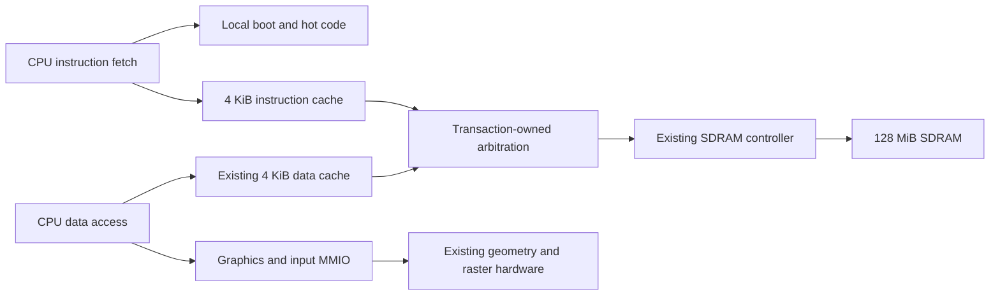

# Local boot and cached SDRAM execution — SDRAM-EXEC-001

Baseline: `f59d74a`, with accepted image/package identities captured before edits.
This is an opt-in execution capability, not a floating-point or SM64 engine port.

## Architecture

The CPU still starts at address zero in 64 KiB local RAM. Local startup checks
CPU feature bit 2, initializes the local stack and clears local/external BSS.
The linker keeps startup and graphics submission routines local and places the
remaining executable and constants in SDRAM. Initialized state and assets are
separate verified loader segments; mutable state is outside the executable range.



The new instruction cache uses 32-byte burst fills and a falling-edge data read.
Its registered tag lookup gets a full cycle; a sequential hint and a line-identity
check prevent a redirect or a held PC from consuming a result for another line.
Warm sequential execution normally advances without a fetch bubble. A warm jump
to another line can incur a lookup bubble. This fitted implementation therefore
differs from the asynchronous-tag characterization prototype's timing schedule.

On a miss the existing global CPU freeze holds every pipeline register and
suppresses retirement. The new execution bridge holds a completed data response
until both instruction fetch and MEM permit advancement. RAM writes, FIFO writes,
MMIO reads and geometry-worker pops are gated during instruction freezes.
Autonomous GPU work and FIFO draining continue.

The arbiter retains response ownership for every burst beat and alternates
contested grants. There is still one SDRAM controller, not simultaneous independent
memory channels. The initial execution image retains the accepted two raster lanes,
setup overlap, geometry worker, 50 MHz clock and disables command DMA.

## Memory and capability contract

| Range | Purpose |
| --- | --- |
| `0x00000000..0x0000ffff` | Local startup, selected hot code/data and stack |
| `0x80000000..0x80ffffff` | Immutable SDRAM executable and constants |
| `0x81000000..0x87ffefff` | Initialized state, external BSS and assets |
| `0x87fff000..0x87ffffff` | Existing SDRAM self-test reservation |

The 16 MiB executable partition and remaining writable partition are explicit
design choices, not measured engine requirements. The linker reserves at least
4 KiB of local stack; it does not provide a dynamic allocator or stack-overflow
trap. `.text.local`/`.text.local.*`, `.local_data` and `.local_bss` let another game
explicitly retain selected routines/state locally. Default globals move to SDRAM.

`ENABLE_SDRAM_EXEC=1` requires SDRAM, caching, bursts and 32-byte data-cache lines.
The board's MMIO and UDP status both advertise `sdram-exec-v1` as CPU feature bit 2
(value 4). The selected worker build advertises CPU `0x80000007`, GPU `3` and
input ABI `0x494e0101`. The default non-executable-SDRAM configuration remains
available; its CPU feature word does not claim this capability.

Four read-only MMIO words report the instruction cache:

| Address | Meaning |
| --- | --- |
| `0x400000f0` | ABI `0x49430101` |
| `0x400000f4` | Hits on advanced external fetch cycles |
| `0x400000f8` | Read misses that start fills |
| `0x400000fc` | Returned fill words, including discarded fills |

These live counters wrap at 32 bits, reset on SDRAM/hardware reset and are not
atomically sampled. Hits are not retired instructions. CPU memory-freeze counters
now include instruction misses and lookup bubbles as well as data stalls.

CPU stores to the executable partition and fetches outside local/executable
aligned ranges freeze the CPU and latch BAD_ACCESS. Loader writes while held
remain allowed. Reset/loading invalidates both caches; outstanding transactions
drain with their original ownership before new requests can reuse responses.
Executable bytes are immutable during play. There is no `FENCE.I` implementation
or supported self-modifying SDRAM code in this capability.

For the execution variant, local RAM uses OLD_DATA for data-port read/write
collisions. A CPU MEM operation is either a load or store; store read-data is
unused and a following load observes the written memory. The normal variant keeps
its previous NEW_DATA setting. Loader WRITE acknowledgements return zero data;
verification remains a separate READ transaction. This avoids a needless collision
forwarding path without weakening the half-cycle timing constraints.

## Reproducible builds

From the repository with pinned source dependencies and the installed LLVM tools:

```powershell
# Same source-neutral game pipeline, new opt-in memory layout:
.\scripts\run.ps1 soc.py portable-game --project build/castle-shaded/audit-fixed.project.json --terrain-direct --packed-gfx --integer-mul --geometry-offload --uncapped-render --interpolate-render --sdram-exec

# Diagnostic and isolated hardware build; does not program the board:
.\scripts\run.ps1 build_sdram_execution.py firmware
.\scripts\run.ps1 build_sdram_execution.py fit

# Package contracts and integrated CPU tests:
.\scripts\run.ps1 test_sdram_execution.py
.\scripts\run.ps1 soc.py sim --simulator modelsim --work-dir build/sdram-exec/final-lib --geometry-worker --disable-command-dma --tests sdram_instruction_cache_tb,sdram_execution_tb,sdram_exec_protection_tb
```

Another game uses the same `--sdram-exec` flag with its own portable project.
The subset and linked MUL-only audits remain mandatory. Floating point, indirect
callbacks and unsupported arithmetic/library helpers have not been enabled.
`--dma-gfx` is rejected for this initial execution target; use packed submission.

Packages retain transport version 1 and add typed `execution` metadata plus the
required CPU feature. The loader checks the executable segment, aligned entry,
writable BSS bounds, segment hashes and nonoverlap before BEGIN. Old hardware is
rejected during read-only capability preflight. Startup also fails locally with
`0xdead00c3` if execution support is absent. ELF sections have distinct load
segments, avoiding huge sparse files across the local/SDRAM address gap.
Asset section alignment is applied to the section address, not a hidden prefix;
the extractor checks section lengths against linker symbols.

Cold startup still requires a verified package load. SDRAM and JTAG configuration
are volatile; this is not a standalone SD-card/flash boot implementation.

## Validation scope and evidence

The diagnostic image is 65,668 bytes of external code **including an intentional
alignment gap**, and actually calls a function at `0x80010000`. It demonstrates
execution beyond the former 64 KiB range, not 65 KiB of SM64 behavior. Directed
tests check local/external initialization, signed subword reads/writes, exactly
128 FIFO bytes across instruction misses, pipeline freezes, redirects/returns,
partial-fill invalidation, code replacement, protected stores and loader takeover
during an accepted CPU memory transaction. End-to-end UDP tests check readback
and the new feature advertisement. Full Mario tests require two presented frames
with substantial terrain/pixel output and no protocol errors.

The Mario build separates 1,900 local image bytes, 27,340 external code/constant
bytes, 12 initialized external state bytes, 9,536 BSS bytes and 883,160 asset bytes.
Asset hashes differ from the old package because embedded pointers relocate;
source game logic, geometry, animation and material policies were not changed.

ModelSim's old shared compilation mode crashed during this integration. Per-file
compilation passes the integrated and full-render tests and is now the default;
`--shared-compilation` explicitly selects the legacy mode. Unsupported active
features are not bypassed to make a package load.

Raw baseline, fit attempts, final verification and measurements are retained under
`docs/benchmarks/sdram-exec-001`. Negative-slack candidates are rejected before
assembly/programming. No new false paths, clock changes or relaxed board delays
were added. Device/board delays remain inherited timing assumptions, not fresh
signal-integrity measurements. Physical results below were recorded after the
gates completed; simulation throughput is not reported as board FPS.

## Measured implementation results

The fourth fit passed all timing and coverage gates and produced
`build/quartus-sdram-exec/SdramExecSoC.sof`, SHA-256
`140fa00e9d66def31e6897be29bc927469de72a9a051481186f7d7b2bc30be15`.
The earlier three fits were rejected at setup slack -2.072, -2.951 and -0.328 ns.
They were never programmed. Repairs moved tags out of inferred RAM, registered
lookup results, removed falling-edge MEM completion from the fetch hint, and
removed an unnecessary local-RAM write-collision forwarding path.

| Fitted resource | Accepted baseline | Execution candidate | Difference |
| --- | ---: | ---: | ---: |
| Logic elements | 26,557 | 30,221 | +3,664 |
| M9K blocks | 366 | 370 | +4 |
| Logical memory bits | 2,659,688 | 2,692,460 | +32,772 |
| DSP 9-bit elements | 92 | 92 | 0 |
| PLLs | 2 | 2 | 0 |

Worst multicorner slack is +0.181 ns setup, +0.084 ns hold, +3.232 ns recovery,
+3.814 ns removal and +9.194 ns minimum pulse width. Constraint coverage has zero
unconstrained setup/hold clocks and input/output paths under the inherited board
assumptions. Margins are narrow; this establishes the current 50 MHz fit, not a
frequency increase or a measured board-delay margin.

Physical validation on October 12 successfully ran the large-image diagnostic,
checked the expected checksum 128, signed-subword result `0xabcd8123`, local
initializer `0x89abcdef`, feature word `0x80000007` and I-cache ABI `0x49430101`.
It recorded 2,552 configured CPU cycles, 1,804 advanced-fetch hits, 17 misses and
136 fill words. These are this diagnostic's values, not general engine costs;
the counters were read separately. CPU and all external initialized segments
were fully uploaded and read back before each release.

| Physical idle samples | FPS sample 1 | Sample 2 | Sample 3 |
| --- | ---: | ---: | ---: |
| Accepted hardware, local-code Mario | 60 | 60 | 60 |
| Candidate hardware, same local-code Mario | 60 | 60 | 60 |
| Candidate hardware, SDRAM code/state Mario | 30 | 30 | 30 |

These are three consecutive three-second frame-counter/wall-clock samples per
placement after a two-second warmup, with one load each. They are not independent
reset trials, an input-controlled movement route, a latency distribution, or a
claim about original SM64 engine performance. The equal displayed rate for the
local-code pair does not prove equal CPU work because presentation can hide extra
work. Migrating this small game to SDRAM incurs a real observed idle-rate cost;
the gain is executable/state capacity. Profiling and explicit placement of hot
state/routines are future work, not silently included optimizations.

At the end of validation the original accepted SOF and exact prior Mario package
were restored with full readback; the frame counter advanced 2 to 62 over the
one-second running check. `profiles/current-deployment.json` still selects that
60-FPS baseline. The new image/package are built and validated but are not the
default active deployment.

[Physical measurements](benchmarks/sdram-exec-001/physical-results.json),
[fit/timing summary](benchmarks/sdram-exec-001/results-summary.json).

To repeat the physical comparison and rollback after building the candidate:
retain the original accepted SOF and the baseline package under
`build/sdram-exec/baseline`. The evidence ZIP retains that exact baseline firmware;
the original SOF is identified by hash and must be preserved separately.

```powershell
.\scripts\run.ps1 verify_sdram_execution.py --physical
```

For explicit deployment of the new package, first program
`build/quartus-sdram-exec/SdramExecSoC.sof` with Quartus, then use:

```powershell
.\scripts\run.ps1 load_game.py build/mario-castle-audit-fixed-sdram-direct-packed-mul-geometry-uncapped-interpolated-exec.package.json
```

The old default programmer reference points to the accepted image and cannot
enable SDRAM instruction fetch. Do not send this package to that image and skip
the loader's capability check.
