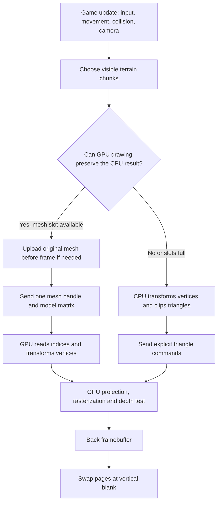

# Terrain offload and finer profiling

This work adds a conservative terrain GPU path and instruments command submission and clipping in more detail. The shared CPU/GPU command interface, imported Mario assets, animation and collision behavior remain the same. The existing MUL-enabled FPGA is used throughout; this change does not modify RTL or board clocks.

## What each part does

The CPU runs game updates, collision queries, camera calculations and actor posing. It decides which terrain chunks are visible and how to submit them. The GPU ultimately projects triangles, rasterizes them, applies depth tests and writes the back framebuffer. VGA displays the front framebuffer and changes pages at vertical blank. Both the direct and resident paths use this GPU for rendering; “offload” here moves more terrain transformation and triangle assembly from the CPU to the GPU.



### Visibility, residency and admission

`world_prepare()` first selects visible chunks using their bounds and room masks. Visibility asks whether something could appear; it does not prove that the whole chunk can safely use GPU transformation.

A resident mesh is original vertex/index data already stored in one of the GPU's 16 mesh handles. Actors reserve their handles; terrain can use the rest. The current hardware allows 128 vertices and 256 triangles per handle. Mesh uploads occur before `BEGIN_FRAME`, so they do not overwrite data while that frame is drawing. Residency is only a rendering cache: collision data continues to come from the original world spatial queries. Running out of mesh handles cannot remove collision or discard visible terrain.

The new `safe_matrix()` admission test proves several stronger conditions:

- Player coordinates and matrix coefficients stay within bounds that prevent arithmetic overflow.
- The chunk's mesh counts fit the hardware.
- The matrix's origin contribution has no fractional remainder. This preserves the CPU's exact signed rounding when the GPU splits local vertex transformation from integer translation.
- Eight transformed bounding-box corners prove that every contained vertex fits the GPU's signed coordinate range and remains entirely inside the CPU's near, far and side planes. A chunk crossing those planes stays on the existing CPU clipping path, avoiding different CPU/GPU clipping results.
- Before the first upload, `bounds_valid()` checks the original vertices against the declared box. A bad box causes fallback rather than authorizing unsafe drawing. This scan is paid when a chunk first becomes resident, rather than every draw.

The matrix is saved during preparation and reused by `world_draw()`. A different player position or view matrix between preparation and drawing invalidates the proof for that draw, which then uses the direct path. The proof is deliberately conservative: it may reject a mesh that a more capable GPU interface could render safely. Rejection does not mean missing geometry; it means CPU fallback.

For one component, the CPU computes:

`floor(4 × dot(local_vertex + chunk_origin − player, view_row) / 256) + view_translation`.

The existing GPU mesh stage computes:

`floor(dot(local_vertex, model_row) / 256) + model_translation`, with `model_row = 4 × view_row`.

An integral origin contribution makes these expressions exactly equal. Simply checking for 16-bit saturation would not prove matching rounding. The renderer must use identity global view for these already-camera-space submissions, as the existing shared-world port does. The proof uses the shared world's declared focal 256, near 257 and far 30,000 policy.

### Direct terrain and clipping

For a fallback chunk, the CPU transforms each shared vertex once and builds six plane outcodes. Each bit says that a vertex lies outside one frustum plane. A triangle whose vertices all share an outside bit can be rejected immediately; a triangle with no outside bits needs no intersections. Other triangles are clipped against the crossed planes.

`fraction()` computes a 12-bit edge fraction using the existing integer algorithm. `intersection()` uses that fraction to interpolate the crossing point's x/y/z coordinates. For example, an edge crossing the near plane gets a new endpoint on that plane instead of projecting a vertex behind the camera. The resulting polygon is triangulated and packed into existing `DRAW_TRIANGLE` commands. This work preserves its existing rounding and plane policy; no divider instruction or replacement clipping algorithm is introduced.

### Command CRC, checks and writes

`gfx_command()` builds a command header, payload and two-byte CRC. The CRC is a checksum that lets the decoder detect a corrupted command stream. Its existing nibble-table calculation remains unchanged.

`send_byte()` checks the GPU error flags and whether the byte FIFO can accept data, then writes the byte to the MMIO data register. Checks answer “may I send?”; a write actually enqueues data. FIFO-capacity waiting is a separate measurement. Sending a command does not mean rasterization has completed: the decoder and GPU process it downstream while the CPU continues.

The optional software FIFO-reservation mode still uses the same byte protocol. This work does not add packed word writes, DMA, a larger FIFO or a new GPU command. Command CRC/check/write timing is now separate so a later transport design can be assessed using measured costs.

### Atomic profiles and timer overhead

`--profile-fine` implies the existing CPU and function profiles. It adds a separate double-buffered **22-word** snapshot with ABI **0x464E0101**, committed with the same completed-frame slot:

| Fine scope | What its timer includes |
|---|---|
| Command CRC | One CRC byte update, plus timer access/call-entry overhead |
| Command checks | Error/readiness checks and their branch work for one send attempt |
| Command writes | One MMIO byte store, plus timer access/call-entry overhead |
| Clip fraction | The existing integer fraction computation |
| Clip intersection | Fraction calculation and coordinate interpolation |
| GPU admission | Conservative matrix/bounds admission |
| Terrain upload | Mesh definition and original vertex/index upload |

Each scope stores cycles and calls. Six event counters record admitted chunks, GPU-drawn chunks, direct-drawn chunks, uploads, trivial triangle accepts and trivial rejects. `profile_cpu.py` pauses the CPU and checks that fine, detail and original phase snapshots all refer to the same completed frame. The existing 53-word phase and 16-word detail ABIs are preserved.

Fine profiling is optional and intrusive. Thousands of per-byte timers add substantial bookkeeping. No timer overhead is subtracted. These are measured instrumented spans, not estimates of uninstrumented operation costs. Intersection includes fraction, upload includes command submission, and scopes overlap the enclosing render phase; do not add nested counters together. Performance comparisons therefore use separate original-pose builds with the fine timers disabled.

## Reusable commands

Run from the repository root:

```powershell
# CPU fallback control with detailed byte/intersection profiling:
.\scripts\run.ps1 soc.py portable-game --project build/castle/game.project.json --terrain-direct --profile-fine --integer-mul

# Optional conservative GPU terrain path with ordinary function profiling:
.\scripts\run.ps1 soc.py portable-game --project build/castle/game.project.json --terrain-gpu-safe --profile-detail --integer-mul

# Add --profile-fine to the GPU build to inspect admission and upload events.
# Omit profiling flags for normal gameplay builds.

# Reproduce the original-pose castle benchmark builds and board comparisons:
.\scripts\run.ps1 measure_terrain_offload.py --build
.\scripts\run.ps1 measure_terrain_offload.py --run

# Validate admission and fallback against production C:
.\scripts\run.ps1 test_terrain_offload.py
```

`--terrain-direct` and `--terrain-gpu-safe` are mutually exclusive. The safe matrix rule applies to resident drawing in the shared renderer; the explicit flag gives that package a separate stem. `--integer-mul` still requires the existing MUL feature bit. The generic flags work with compatible shared-world game ports; the original-idle-pose benchmark helper and its preserved baseline are specifically for this castle experiment.

## Validation and measured results

Implementation baseline is `6b8a298`; candidate implementation is `3cec385`. Five new host tests cover exact expanded GPU/direct triangle streams, mesh capacity fallback, changed position/view, bad bounds, rounding/frustum limits and 1,000 randomized box cases with sampled vertices. The existing 29 world/collision/CRC tests and 13 portable-pipeline tests also pass. No full-frame pixel checksum or complete-level traversal validation is claimed. Existing rendering/collision defects are not claimed fixed.

The following measurement section is generated from the physical trial records, with original assets matched across castle builds and a separate authored fixture used to exercise admitted terrain.

### Castle: fallback preserves the result, but offload is not yet useful here

Three physical trials per case use the original idle pose, standing spawn and immutable 883,124-byte asset segment. All fifteen stationary snapshots below match seven GPU event counts: 444 submitted triangles, 6 clipped, 185 culled, 264,023 bounding-box pixels, 91,151 inside pixels, 6,154 depth rejects and 84,997 writes.

| Castle case | Median CPU render cycles | Calculated ms at 50 MHz | Median observed FPS |
|---|---:|---:|---:|
| Preserved pre-change original-pose baseline | 945,793 | 18.91586 | 29.969 |
| New direct control, fine timers disabled | 934,397 | 18.68794 | 29.969 |
| Safe resident candidate, fine timers disabled | 937,682 | 18.75364 | 30.075 |
| Fine direct diagnostic | 1,491,015 | 29.82030 | 19.927 |
| Fine safe diagnostic | 1,500,746 | 30.01492 | 19.915 |

The candidate admits **zero terrain chunks** in all captured standing/movement fine snapshots; all eight visible chunks draw through fallback. The [host admission diagnostic](benchmarks/terrain-offload-001/castle-admission.json), running the production camera at the same spawn after 40 neutral updates, finds that every chunk has a fractional translation contribution and its box exceeds the safe frustum. Their source boxes correctly contain the original vertices. This diagnostic explains rejection; its execution time is not a physical measurement.

The new direct control records 281,882 command cycles rather than the baseline's 294,210. Its whole render phase is a calculated **1.205% shorter**. The changes to readiness control flow/compiler code layout accompany this result; this is not a GPU offload improvement or an isolated timer-instruction effect. The safe candidate adds 3,285 render cycles over the new direct control, **0.06570 ms / 0.352%**, while falling back. All three cases remain approximately 30 FPS; the host-window difference does not establish an FPS gain.

Fine direct profiling adds **556,618 render cycles / 11.13236 ms** over its matching direct control. Its command total rises to 809,867 cycles / 16.19734 ms. This large diagnostic overhead is why fine profiles are not deployed for normal gameplay. Both direct controls and the safe castle candidate retain 7,011 bytes / 242 commands and record no FIFO wait in these standing snapshots.

### Individual operations: instrumented spans, not uninstrumented estimates

The standing fine direct medians are:

| Operation | Measured cycles | Calculated ms | Calls |
|---|---:|---:|---:|
| CRC byte updates | 175,019 | 3.50038 | 6,527 |
| Error/readiness checks | 126,198 | 2.52396 | 7,011 |
| MMIO byte writes | 77,121 | 1.54242 | 7,011 |
| Clipping fractions | 50,724 | 1.01448 | 290 |
| Whole clipping intersections, including fractions | 69,864 | 1.39728 | 290 |

CRC calls equal transmitted bytes minus two checksum bytes per command; writes equal transmitted bytes. Those identities hold in every fine snapshot. Of 785 triangle classification calls, the standing frame records 79 trivial accepts and 596 trivial rejects; the remaining triangles require clipping work. Intersection count is not the number of clipped triangles: a triangle can cross multiple edges/planes.

The moving fine safe diagnostic has median CRC 229,031 cycles / 8,543 calls; checks 165,510 / 9,195; writes 101,145 / 9,195; fractions 55,268 / 314; and intersections 75,992 / 314. Movement endpoints differ between trials, so these are diagnostic medians rather than an identical-route comparison. Admission takes median 2,120 cycles for eight calls in movement, and 2,234 cycles in standing. Warmed castle frames record no terrain uploads because no chunk is admitted.

Fraction is nested inside intersection; both are nested inside clipping. In this fine standing build the enclosing clipping scope is 228,159 cycles. Timer bookkeeping outside each fine span still appears in its enclosing scope. Neither subtracting nested totals nor treating these numbers as shares of the old 4.05-ms uninstrumented-fine clipping span yields a clean arithmetic breakdown. The exact individual uninstrumented costs remain unmeasured.

### Admitted-terrain FPGA fixture

A separate authored grid has **128 vertices and 210 triangles**, one bounded terrain chunk, a fixed identity view, and no drawn actor. Its shared-world project retains an unused resident cube mesh; GPU frame counters therefore describe the 210 terrain triangles. Both variants use the same 2,124-byte authored asset segment and the same reusable compiler/runtime. It is a functional/performance fixture, not an imported Mario scene or a whole-game benchmark.

| Warmed authored fixture, three trials each | CPU direct | Safe GPU resident |
|---|---:|---:|
| CPU render cycles | 365,114 | 9,083 |
| CPU render ms | 7.30228 | 0.18166 |
| Command cycles | 240,577 | 3,226 |
| Transmitted bytes | 5,509 | 81 |
| Commands | 213 | 4 |
| FIFO wait span cycles | 19,609 | 0 |
| Median observed FPS | 30.062 | 30.075 |

CPU render cycles fall a calculated **97.512%** in this deliberately eligible fixture. The fine safe fixture separately records one admitted chunk, one GPU-drawn chunk, zero direct chunks and zero uploads after warmup. First-frame upload work is not included in the steady-state reduction. These results do not measure upload spikes or churn while moving between many chunks.

All nine fixture snapshots match the same seven GPU event counts: 210 submitted triangles, no clipped or culled triangles, 3,654 bounding-box pixels, 2,190 inside pixels, 1,063 depth rejects and 1,127 writes. Along with the production-C exact triangle-stream tests, this supports that resident rendering preserved the tested geometry. It remains short of a full framebuffer checksum or all-scene proof.

Both variants remain approximately 30 FPS under the existing simulation/presentation cadence. The fixture's large explicit tick waits must not be omitted: `frame_wall_cycles` starts after tick waiting, so that metric alone is not its full frame interval. GPU stage counters also overlap; they cannot be summed as serial costs. This faster producer does show FIFO waiting in the direct fixture, illustrating why the castle's zero FIFO wait must not be generalized to every workload.

## What to do next with these findings

1. To make castle offload useful, first make the render chunks spatially tighter while retaining every source face and collision record. The current packer sorts by centroid but merges across cells until mesh capacity is reached, producing broad boxes. Compare direct and resident rendering on the identical repacked assets and preserve source-triangle provenance; do not treat different chunk layouts as identical work.
2. Exact origin rounding is a separate barrier. Consider a GPU interface that preserves fractional translation through the final model dot-product shift, or a separately proved equivalent representation. Do not remove the guard and silently accept different coordinates. Crossing-frustum chunks additionally need proven CPU/GPU clipping parity before relaxing the full-frustum rule.
3. Command CRC/check/write scopes are now observable. The CRC span is the largest of these fine scopes, but profiling overhead prevents claiming its original percentage. Before choosing packed MMIO or CRC acceleration, use a lower-overhead sampled or isolated transport probe. Packed writes do not eliminate checksum or command-building work.
4. Clipping fractions are measurable and relatively bounded in these views. A divider experiment must preserve the existing 12-bit fraction and rounding. Replacing it with `(numerator << 12) / denominator` can overflow a 32-bit numerator; the current iterative algorithm avoids that. No DIV speedup claim or divider implementation follows from this measurement alone.

The implementation and measurement tools are available now. A general game still needs an adapter for its engine behavior, assets and supported rendering features; conservative offload does not make arbitrary engines automatically loadable.

## Saved evidence and current state

[Measurements and SHA-256 manifest](benchmarks/terrain-offload-001/measurements.json) preserve all **27 physical trials**, packages/symbols/opcode audits, relevant source snapshots, original command/render sources, the authored fixture, build/run helpers, logs and restoration status. Raw files retain their original bytes. The earlier un-fixed-pose exploratory fine run is kept locally outside the reported comparison.

The board was restored to normal animated, unprofiled direct MUL Mario and advancing frames were verified (2 to 11). The optional normal candidate is `build/mario-castle-sdram-gpu-safe-mul.package.json`; it is built separately and is not claimed to improve castle FPS. To try it explicitly:

```powershell
.\scripts\run.ps1 load_game.py build/mario-castle-sdram-gpu-safe-mul.package.json --status
```

Existing SOF file SHA-256 is `84de9a3059e5a40957438df348da434c05e462955e60528491f2f2ac6713484b`. No FPGA reprogramming or new fitter/resource measurement was performed. Archived helpers originally in `build/terrain-offload` should be copied back to that directory before reproduction; the authored fixture helper restores castle generated headers and normal Mario even after a failed measurement.

Resume-safe wording: “Implemented conservative, exact-rounding terrain GPU offload and atomic command/clipping profiles in an FPGA SoC; measured a 97.51% reduction in CPU render cycles on an eligible 210-triangle authored fixture with matching GPU event counts, while identifying chunk bounds and fractional translation as barriers to castle-level offload. No castle FPS improvement was established.”
